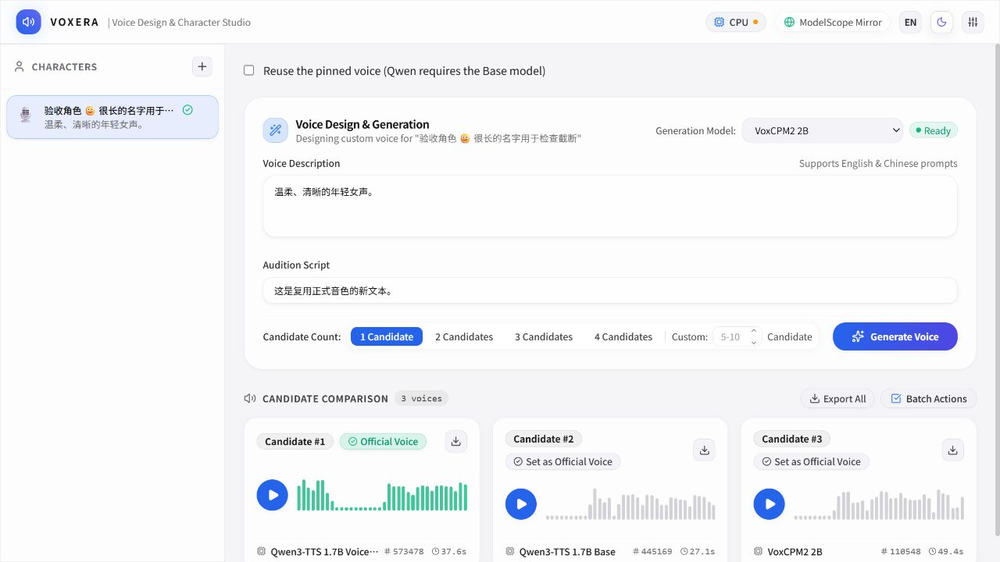

# Voxera

**English** | [简体中文](README.zh-CN.md)

A local voice design and character audio studio. Describe a voice, compare candidates, pin your favorite, and reuse it for new dialogue.

**0.1.1 Alpha · Windows x64 portable**

[Download v0.1.1](https://github.com/eoeac/voxera/releases/tag/v0.1.1) · [Listen to samples](docs/samples/README.md) · [Report an issue](https://github.com/eoeac/voxera/issues)



## What you can do

- Design voices from English or Chinese descriptions using Qwen3-TTS VoiceDesign or VoxCPM2.
- Compare **4 candidates by default**, with **1–10** supported, and audition one audio clip at a time.
- Organize clips by character, pin a reference voice, and generate new lines with that reference. Qwen reuse requires the separate Base model.
- Export WAV files or a ZIP, track generation progress, and resume monitoring after a refresh.
- Use English or Simplified Chinese, with dark and light themes. **English is the default**, regardless of your system language; your manual language choice is remembered.

Inference runs locally after model downloads. CPU generation has been tested; speed, voice quality, and consistency depend on the model, text, and hardware. This is an early Alpha, with CUDA/MPS and other platforms awaiting hardware validation.

## Run the Windows portable build

1. Download the ZIP and its `.sha256` file from [v0.1.1 Releases](https://github.com/eoeac/voxera/releases/tag/v0.1.1).
2. Extract the entire ZIP to a writable folder and launch `Voxera.exe`.
3. Download a model in the setup wizard or settings. Voice reuse with Qwen also needs Qwen3-TTS Base.
4. Create a character, describe the voice, enter dialogue, and generate candidates. Pin one and enable **Reuse the pinned voice** to generate another line.

Requirements: **Windows 10/11 x64**, [Microsoft Edge WebView2 Runtime](https://developer.microsoft.com/en-us/microsoft-edge/webview2/), and sufficient disk space. Each model is approximately 4.5–5 GB; allow at least 25 GB for the runtime, models, and download caches. A 16 GB RAM starting point is suggested, but this is not a measured minimum. CPU inference works and can be slow.

No system Python installation is needed. Model weights are downloaded separately and are not bundled in the ZIP. Voxera probes ModelScope, Hugging Face, and HF Mirror and falls back between sources; the source installer can choose Tsinghua or official PyPI. Initial setup, downloads, and network diagnostics require a connection.

Closing the window shuts down the engine. `stop.bat` checks process identity before stopping an idle engine and refuses while generation or downloads are active. Close the app before moving or backing up its folder. Keep `data/`, `audio/`, and `models/` together. WebView, the OS, and third-party libraries may keep additional caches.

To check the ZIP in PowerShell, run `Get-FileHash .\Voxera-v0.1.1-Windows-x64-Portable.zip -Algorithm SHA256` and compare the result with the `.sha256` file.

## Run from source

Install **Python 3.12**, **Node.js 22+**, and [uv](https://docs.astral.sh/uv/getting-started/installation/). Dependency versions are captured in `uv.lock` and `app/package-lock.json`.

```powershell
git clone https://github.com/eoeac/voxera.git
cd voxera
python tools/bootstrap.py
cd app
npm ci
npm run build
cd ..
.venv\Scripts\python.exe -m engine.server
```

Open `http://127.0.0.1:28840`. `bootstrap.py` installs hashed, locked dependencies into the project's `.venv`, with official/Tsinghua PyPI fallback; it does not install into global Python. Alternatively, run `uv sync --locked --extra inference --extra desktop --extra dev` against the official index. For the Windows native window, use `.venv\Scripts\python.exe -m engine.desktop`.

For frontend development, keep the engine running and start `npm --prefix app run dev` in another terminal; open `http://localhost:5173`. Linux/macOS browser mode can be explored from source, but this release has no validated packages for those platforms or MPS.

## Models and reproducibility

| Model | Purpose |
| --- | --- |
| Qwen3-TTS 1.7B VoiceDesign | Create a voice from a description |
| Qwen3-TTS 1.7B Base | Reuse a pinned Qwen reference with new text |
| VoxCPM2 2B | Voice design and reference audio generation |

Generation batches run serially in one engine, with at most 10 batches queued. Switching models unloads the previous adapter. Records include weight content versions, Seed, device, parameters, dependency versions, and elapsed time. Identical seeds do not guarantee identical audio across devices or package versions.

[CPU samples](docs/samples/README.md) and [implementation/validation notes (中文)](docs/implementation-2026-09-30.md) document the tested environment and boundaries. No objective voice similarity or quality score is claimed. GPU detection and runtime installation alone are not evidence of tested GPU performance.

## Development and architecture

- UI: React 19, TypeScript, Vite, and TailwindCSS.
- Windows host: C# launcher → `engine.desktop` → pywebview/WebView2 and FastAPI.
- Engine: Python 3.12, FastAPI, SQLite, and SQLAlchemy, listening on loopback only.
- `src-tauri/`: experimental window shell; not the current portable host.
- Storage: `VOXERA_HOME` override, otherwise the portable/project folder when applicable, or `~/.voxera`.

```powershell
.venv\Scripts\python.exe -m unittest discover -s tests -v
npm --prefix app run lint
npm --prefix app run build
# Requires a complete runtime; refuses to overwrite an existing version.
runtime\python.exe tools\package_release.py
```

CI covers lightweight engine tests on Windows/Ubuntu and frontend lint/build. Real inference is validated separately. Portable archives include package inventories, third-party licenses, a per-file SHA-256 manifest, and an archive checksum; they exclude personal data and weights.

[Contributing](CONTRIBUTING.md) · [Security and privacy](SECURITY.md) · [Changelog](CHANGELOG.md) · [Architecture (中文)](docs/architecture.md)

Voxera's own code is [MIT licensed](LICENSE). Models and dependencies retain their own terms; see [Third-party notices](THIRD_PARTY_NOTICES.md). Use voices with the speaker's consent and follow applicable model terms.
